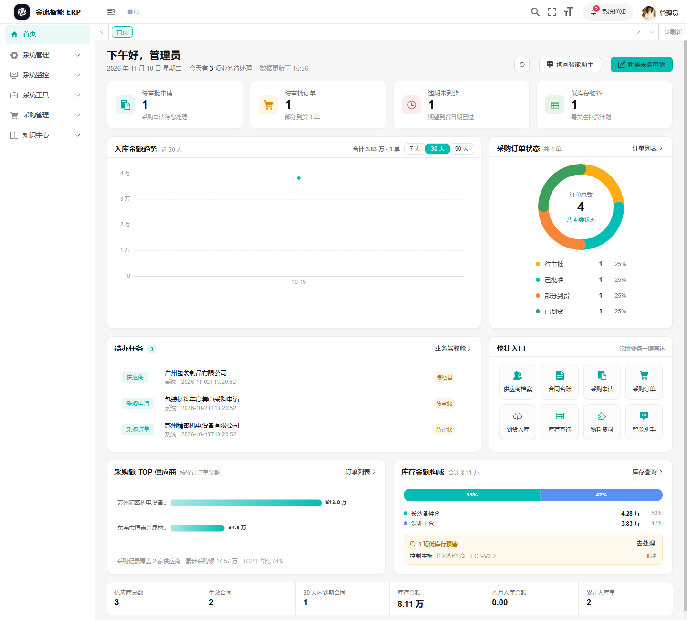
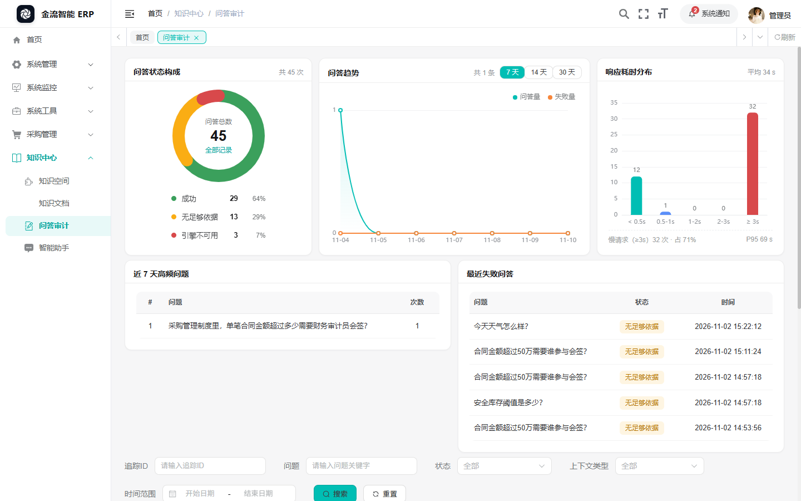
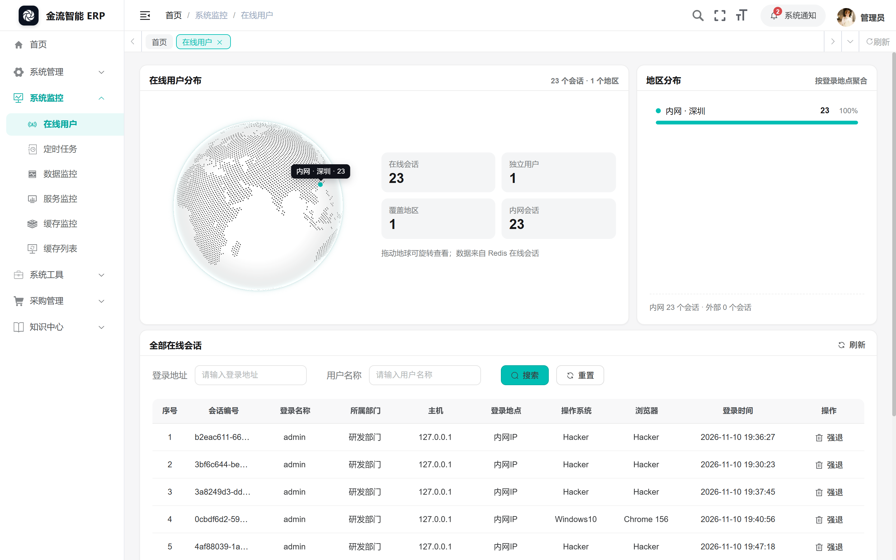

<p align="center">
  
</p>

<h1 align="center">金流智能 ERP</h1>

<p align="center">采购 · 合同 · 库存 · 企业知识库，在一个工作台里闭环</p>

<p align="center">
  
  
  
  
  
</p>

## 项目简介

金流智能 ERP 是在 [RuoYi-Vue](https://gitee.com/y_project/RuoYi-Vue) 基础上二次开发的采购与知识一体化系统。它把「采购申请 → 审批 → 订单 → 到货入库 → 库存流水」的业务链，和「知识空间 → 文档解析 → 检索问答 → 问答审计」的知识链放进同一个工作台：

- **业务闭环**：供应商准入、合同台账、采购申请、采购订单、到货入库、库存余额与流水，状态由单据自动推导，不需要手工维护。
- **知识可答**：文档上传后交给 RAGFlow 解析建索引，智能助手以 SSE 流式作答并给出引用原文；每一次问答都落审计表，可按追踪 ID、状态、耗时回溯。
- **可视化优先**：驾驶舱与各业务页配环形图、2D/3D 趋势图、票券式订单卡、点阵地球等自绘组件，全部零重型依赖（ECharts + Canvas/WebGL + CSS）。

## 界面预览

| 工作台首页 | 问答审计 |
| --- | --- |
|  |  |

| 在线用户分布 |
| --- |
|  |

## 功能模块

### 采购与库存（`ruoyi-erp`）

| 模块 | 说明 |
| --- | --- |
| 采购驾驶舱 | 指标卡、入库金额趋势（2D/3D 可切换）、订单状态环形图、待办与低库存预警 |
| 供应商档案 | 准入审批、风险等级、统一社会信用代码、银行信息 |
| 合同台账 | 合同签订与审批、到期提醒（30 天内到期单独统计） |
| 采购申请 | 明细行、审批流、转采购订单 |
| 采购订单 | 明细行、审批、两种视图（表格 / 票券卡片）、取消与到货进度 |
| 到货入库 | 按订单带出明细，录入到货 / 合格 / 不合格数量，确认后回写订单与库存 |
| 库存查询 | 余额与流水（RECEIPT 入库、调整等），低库存阈值预警 |
| 基础资料 | 物料、仓库维护 |
| 我的打卡 | 个人中心每日打卡、热力强度、当日待办与自动化任务 |

订单状态不是人工填写，而是由到货明细推导：任一行 `received_quantity > 0` 为「部分到货」，全部行 `received >= quantity` 为「已到货」，否则为「已批准」；反审核会回退数量并重新计算（`ErpWorkflowServiceImpl.refreshOrderStatus()`）。

### 知识引擎（`ruoyi-knowledge`）

| 模块 | 说明 |
| --- | --- |
| 知识空间 | 空间与 ACL 授权，创建时自动在 RAGFlow 建数据集 |
| 知识文档 | 上传、版本管理、解析状态轮询（UPLOADED → INDEXING → READY / FAILED）、重试、停用、预览下载 |
| 智能助手 | 基于 RAGFlow chat assistant 的 SSE 流式问答，返回引用卡片；可挂到合同 / 订单 / 供应商的「知识」抽屉 |
| 问答审计 | 状态、耗时、模型、错误信息、高频问题与最近失败，配环形图 / 趋势图 / 耗时分布 |

检索范围按「空间 ACL ∩ 业务对象可见性 ∩ 文档 READY 且为当前版本」求交集；RAGFlow 不可用时采购业务照常运行，助手返回「知识服务不可用」。

### 可视化与交互组件（`ruoyi-ui/src/components`）

| 组件 | 使用位置 | 说明 |
| --- | --- | --- |
| `DonutChart` + `Legend` | 首页、采购驾驶舱、问答审计 | SVG 环形占比图，扇区逐段描边动画、悬停发光放大、圆心内容随 hover 联动 |
| `RidgeChart` + `ChartModeSwitch` | 三处趋势图 | 同一份数据的第二种表现：等距「山脉」视图，Canvas 2D 手绘、Catmull-Rom 重采样、分面光照与地面投影，可 2D/3D 切换 |
| `TicketCard` + `DitheringSurface` | 采购订单卡片视图 | 票券版式 + WebGL2 抖动纹理；状态动效：已到货沿虚线撕开并整片剥落、已批准方形盖章、待审批表盘转动、部分到货像素自下而上填充 |
| `CobeGlobe` | 在线用户 | 点阵地球，按登录地聚合标记、弧线与标签，可拖拽旋转 |
| `ParticlesBg` | 锁屏 | WebGL2 实例化粒子背景，指针视差、点击冲击波 |
| `ImageGenLoader` + `UploadProgress` | 全站上传 | 点阵波浪的水位即上传进度，右下角浮层汇总多文件进度，失败转红 |
| `JobStatus` / `BellToggle` / `FullscreenToggle` | 定时任务、顶栏 | 整行勾选动效（对勾描画 + 烟花）、铃铛声波、全屏图标切换 |
| 叶轮 loading | 全站 `v-loading`、首屏 | logo 叶轮旋转（CSS mask，去底色），首屏 `index.html` 同款 |

### 平台能力（继承若依）

用户、部门、岗位、角色、菜单、字典、参数、通知公告、操作日志、登录日志、在线用户、定时任务、代码生成、服务监控、缓存监控、连接池监视。

## 技术栈

| 层 | 选型 |
| --- | --- |
| 后端 | Java 17、Spring Boot 4.1.0、Spring Security + JWT、MyBatis、Druid、PageHelper、Quartz、SpringDoc |
| 存储 | MySQL 8（utf8mb4）、Redis（缓存与令牌） |
| 前端 | Vue 3.5、Vite 6、Element Plus 2.13、Pinia 3、Vue Router 4、ECharts 5.6、axios、Quill 2、xlsx、cobe 2 |
| 知识引擎 | RAGFlow v0.26.x（REST + SSE，可选依赖） |

## 目录结构

```text
JL_ERP
├─ ruoyi-admin          启动模块：/erp/**、/knowledge/**、/assistant/** 入口与 application*.yml
├─ ruoyi-erp            采购与库存：供应商 / 合同 / 申请 / 订单 / 到货 / 库存 / 审批 / 驾驶舱 / 打卡
├─ ruoyi-knowledge      知识引擎适配：空间 ACL、文档解析、RAGFlow 客户端、助手、问答审计
├─ ruoyi-common         通用工具与基础实体
├─ ruoyi-framework      安全、拦截器、数据源、多端登录等框架能力
├─ ruoyi-system         系统管理（用户 / 角色 / 菜单 / 字典 / 通知 …）
├─ ruoyi-quartz         定时任务
├─ ruoyi-generator      代码生成
├─ ruoyi-ui            前端工程（vite + src/views/erp|knowledge|assistant + src/components）
├─ sql                  数据库脚本（按下列顺序导入）
├─ docs                 部署与运维手册、界面截图
├─ start-demo.ps1       本地一键启动（可指定端口，默认 18085）
└─ stop-demo.ps1        停止本地进程
```

## 快速开始

### 1. 环境要求

| 组件 | 版本 |
| --- | --- |
| JDK | 17+ |
| Maven | 3.9+ |
| MySQL | 8.0+（utf8mb4） |
| Redis | 5.0+ |
| Node.js | 18+ / 20+ |
| RAGFlow | v0.26.x（可选，不影响采购业务） |

### 2. 初始化数据库（顺序不可颠倒）

```bash
mysql -uroot -p -e "create database \`ry-vue\` default charset utf8mb4 collate utf8mb4_general_ci;"
mysql -uroot -p ry-vue < sql/ry_20260417.sql          # 若依基础表与菜单
mysql -uroot -p ry-vue < sql/quartz.sql               # 定时任务表
mysql -uroot -p ry-vue < sql/erp_knowledge_20261101.sql   # ERP + 知识模块表、菜单、角色、演示数据
mysql -uroot -p ry-vue < sql/erp_checkin.sql          # 每日打卡（可选，个人中心用）
mysql -uroot -p ry-vue < sql/erp_day_task.sql         # 打卡当日待办/自动化演示数据（可选）
```

`erp_knowledge_20261101.sql` 可重复执行：会先定向清理 `sys_menu(2000-3999)`、`sys_role(2001-2006)`、`sys_user(200-205)`、`sys_dept(200-204)`、`erp_*` 字典与业务表，再重建并写入演示数据。

### 3. 配置

- `ruoyi-admin/src/main/resources/application-druid.yml`：数据库地址与账号；
- `ruoyi-admin/src/main/resources/application.yml`：Redis、上传目录、JWT 密钥；RAGFlow 相关项（`RAGFLOW_BASE_URL` / `RAGFLOW_API_KEY` / `RAGFLOW_CHAT_ID`）建议用环境变量注入，**Key 只留在服务端**。

完整变量表、RAGFlow 初始化、验收步骤、故障排查见 [docs/deployment.md](docs/deployment.md)。

### 4. 启动

```bash
# 后端
mvn -DskipTests package
java -jar ruoyi-admin/target/ruoyi-admin.jar        # 默认 http://localhost:8080

# 前端
cd ruoyi-ui
npm install
npm run dev        # 默认 http://localhost:80，/dev-api 代理到后端
npm run build:prod # 产物在 ruoyi-ui/dist
```

Windows 下也可以用脚本启停：`powershell -File start-demo.ps1 -Port 18085`、`powershell -File stop-demo.ps1`。前端端口可用 `VITE_PORT=8081` 覆盖。

### 5. 演示账号

统一初始密码 `admin123`：

| 账号 | 角色 | 用途 |
| --- | --- | --- |
| `admin` | 超级管理员 | 全量权限 |
| `caigou` | 采购员 | 建供应商 / 合同 / 申请 / 订单 |
| `fuzeren` | 采购负责人 | 审批准入、申请、订单 |
| `caiwu` | 财务审计员 | 审计与付款条款查看 |
| `cgy` | 仓管员 | 到货入库、库存查询 |
| `shenji` | 财务审计员 | 问答审计、操作日志 |
| `zhishi` | 知识管理员 | 知识空间、文档、ACL |

## 说明

- 演示数据里的知识空间带占位 `rag_dataset_id`，示例文档为 `UPLOADED` 状态且未建索引，不参与检索；要跑通问答请在对应空间上传真实 PDF/Word，文档会自动解析并轮询到 `READY`。
- 前端上传统一走点阵波浪进度：`utils/request.js` 接管所有 `FormData` 的 `onUploadProgress`，知识文档弹窗内嵌一份，其余入口用右下角浮层。
- 后端接口遵守若依约定（`/list`、`/{id}`、`POST`、`PUT`、`DELETE /{ids}`、`POST /export`），权限标识见各 Controller 的 `@PreAuthorize`。

## 致谢与许可

本项目基于 [RuoYi-Vue](https://gitee.com/y_project/RuoYi-Vue)（Copyright (c) 2018 RuoYi，MIT）二次开发，新增 `ruoyi-erp`、`ruoyi-knowledge` 业务模块与前端可视化组件；原框架的版权声明与 MIT 许可保留在 [LICENSE](LICENSE)。
